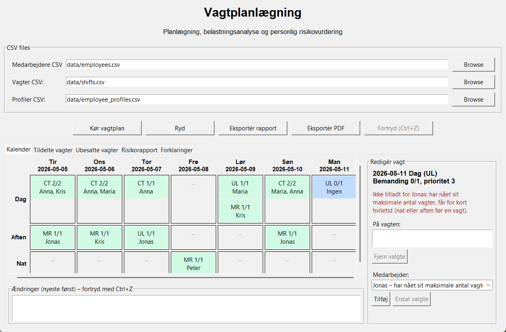
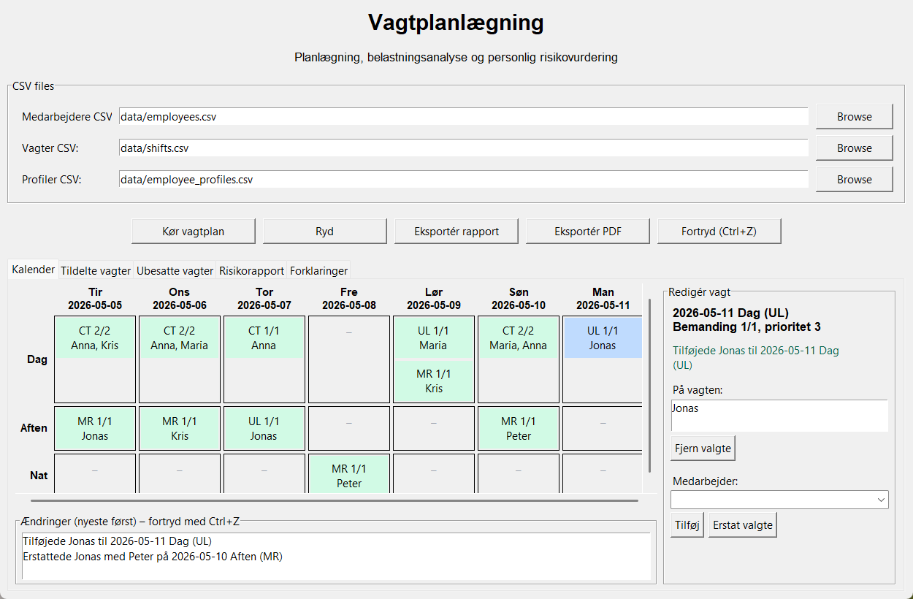
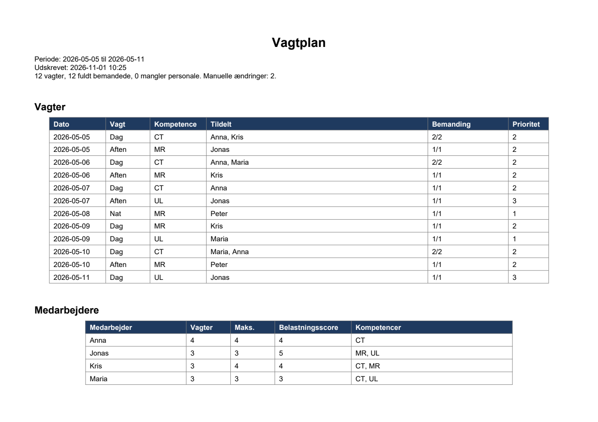

# Python Shift Planner Desktop

Desktop-based shift planning and workload analysis system built in Python.

The project focuses on:

- Intelligent shift assignment
- Workload balancing
- Employee well-being analysis
- Personalized workload scoring
- Risk detection
- Transparent assignment explanations
- GUI-based schedule analysis

The system is inspired by real-world healthcare scheduling challenges in 24/7 departments.

---

## Features

### Shift Planning

- Assign employees to shifts based on:
  - Skills
  - Capacity
  - Rest time rules
  - Shift conflicts
  - Personalized workload tolerance

### Workload & Risk Analysis

- Workload score calculation
- Personalized workload scoring
- Employee risk analysis
- Heavy shift detection
- Capacity warnings
- Unassigned shift tracking

### GUI Application

- Desktop GUI built with Tkinter
- CSV file selection
- Interactive tables
- Shift explanation viewer
- Report export to `.txt`
- Editable calendar (dates × day/evening/night) with staffing status per shift
- Manual add, remove and replace of employees, checked by the scheduler's own rules
- Undo of manual changes (button or Ctrl+Z) with a change history
- PDF export of the current, possibly edited, schedule

### Assignment Transparency

The system explains WHY employees were assigned:

- Required skill match
- Preferred shift match
- Personalized workload score
- Eligibility reasoning

---

# Screenshots

## Editable calendar

A change that breaks a scheduling rule is refused with every reason (here Jonas is at capacity and would get too little rest after an evening shift):



After replacing Jonas with Peter on Sunday evening, Jonas can take Monday's open UL shift. The history lists both changes:



Undo (button or Ctrl+Z) reverts the latest change exactly:


## PDF export



---

## Technologies

- Python 3.12
- Tkinter
- ReportLab (PDF export)
- Pytest
- CSV-based data import

---

## Project Structure

```text
python-shift-planner-desktop/
│
├── app/
│   ├── gui.py
│   ├── calendar_view.py
│   ├── schedule_editor.py
│   ├── pdf_export.py
│   ├── main.py
│   ├── scheduler.py
│   ├── models.py
│   ├── reporting.py
│   ├── csv_loader.py
│   ├── personalized_workload.py
│   ├── assignment_explanation.py
│   └── constants.py
│
├── data/
│   ├── employees.csv
│   ├── shifts.csv
│   └── employee_profiles.csv
│
├── tests/
│
├── requirements.txt
├── pytest.ini
└── README.md
```

---

# Installation

Clone repository:

```bash
git clone https://github.com/kris7011/python-shift-planner-desktop.git
```

Navigate to project:

```bash
cd python-shift-planner-desktop
```

Install dependencies:

```bash
pip install -r requirements.txt
```

---

# Run Application

Run GUI:

```bash
py -m app.gui
```

Run tests:

```bash
pytest
```

## Editing the schedule

1. Click **Kør vagtplan** to generate the schedule from the CSV files.
2. Open the **Kalender** tab and click a shift. Green shifts are fully staffed, red shifts miss people, blue is selected.
3. Choose an employee and click **Tilføj**, select someone on the shift and click **Fjern valgte**, or select both and click **Erstat valgte**. The list shows every employee; those who cannot take the shift show why.
4. Every change is checked with the same rules as the scheduler: required skill, maximum number of shifts, one shift per day, and rest time (no shift the day after a night, no day shift after an evening). A refused change shows all reasons and changes nothing.
5. **Fortryd (Ctrl+Z)** reverts the latest change. The other tabs (assigned, unassigned, risk, explanations) update after every change.

Changes live in memory only: **the CSV files are never written**. Clicking **Kør vagtplan** again rebuilds the plan from the CSV files and asks first if there are manual changes.

## PDF export

**Eksportér PDF** saves the current schedule: period, print time, number of manual changes, every shift with its staff (shifts missing people are highlighted) and each employee's shifts and workload. The save dialog asks before replacing an existing file. The PDF is written to a temporary file first and then moved into place, so a failed export never damages an existing file.

---

# CSV Data Format

## employees.csv

```csv
name,max_shifts,skills
Kris,4,CT;MR
Anna,4,CT
Peter,4,MR
```

## shifts.csv

```csv
date,shift_type,required_skill,required_staff,priority,workload_score
2026-05-05,Day,CT,2,2,1
2026-05-05,Evening,MR,1,2,2
```

## employee_profiles.csv

```csv
employee_id,name,night_tolerance,weekend_tolerance,late_tolerance,max_weekly_load,preferred_shift
1,Anna,0.4,0.6,0.8,35,DAY
```

---

# Current Capabilities

- Multi-staff shift assignment
- Risk scoring
- Personalized workload analysis
- Rest-time validation
- GUI reporting
- Report export
- Interactive explanations
- Editable calendar with rule-checked manual changes
- Undo of manual changes
- PDF export

---

# Planned Features

- SQLite database
- Drag-and-drop scheduling
- Saving an edited schedule (today edits are kept in memory and exported as PDF)
- Fairness optimization
- AI-assisted scheduling
- What-if simulations
- Employee preference management
- Real-world agreement rules

---

# Testing

Project includes automated unit tests using Pytest.

Current coverage includes:

- Employee rules
- Shift rules
- CSV loading
- Personalized workload scoring
- Scheduler behavior
- Schedule editing: add, remove and replace through the scheduler's rules, refused changes leaving the schedule untouched, and undo restoring the exact earlier state (including order)
- Calendar grouping by date and shift type
- PDF export: content, no overwrite without permission, an existing file kept when an export fails, and input CSV files unchanged after editing and exporting

The GUI itself (`calendar_view.py`, `gui.py`) is not covered by automated tests; its rules and state live in `schedule_editor.py`, which is. See [docs/PROJECT_WALKTHROUGH.md](docs/PROJECT_WALKTHROUGH.md) for the desktop demonstration.

---

# Purpose

This project was created as part of a larger initiative exploring:

- Workforce planning
- Employee well-being
- Scheduling optimization
- Healthcare operations
- Explainable scheduling systems

---

# Status

Active development.

The project is continuously evolving with new scheduling logic, GUI improvements, and workload analysis features.
